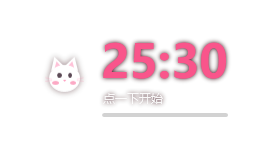
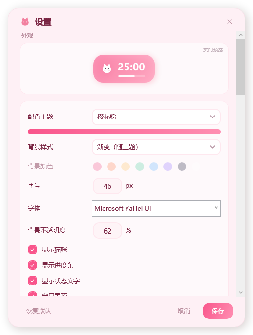
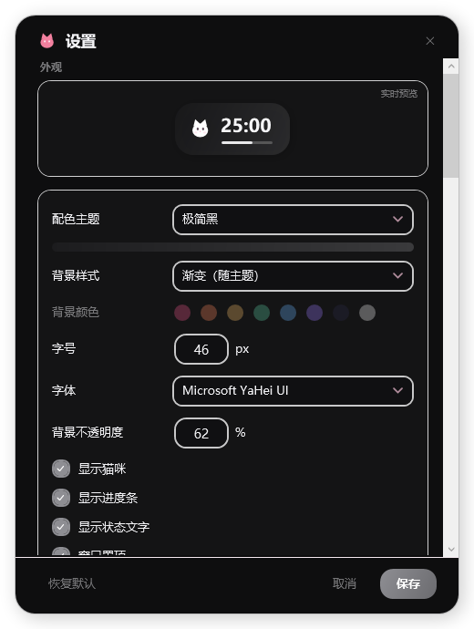

# 喵时 MeowTimer 🐱


一个很轻的 Windows 桌面倒计时 / 番茄钟。没有窗口边框，可以拖到屏幕任意角落，平时就安安静静趴着显示时间。

双击不用找图标，点击数字就能开始。

<p align="center">
  
</p>

## 它长这样

| 编辑模式（可拖拽缩放） | 无背景 · 只留数字 |
| --- | --- |
|  |  |

| 设置面板（跟随主题换色） | 深色主题 |
| --- | --- |
|  |  |

## 功能

**计时**
- 倒计时（精确到秒）、时钟、番茄钟、专注/休息循环四种模式
- 番茄钟与循环都可以设时 / 分 / 秒，自动进入下一阶段
- 计时结束闪烁提醒、提前提醒

**窗口**
- 无边框圆角，拖动任意位置，位置自动记住
- 编辑模式下拖右下角小圆点，整体等比缩放
- 可锁定位置，防止误碰
- 置顶 / 不置顶可选

**外观**
- 6 套配色：樱花粉、奶油布丁、薄荷苏打、夜空紫、落日橘、极简黑
- 其中夜空紫、极简黑是完整深色模式（设置面板也是暗色）
- 背景可选渐变 / 纯色（8 色可选）/ 完全无背景，不透明度 0–100%
- 文字颜色独立于主题，浅色字自动配深描边
- 字号 18–130，字体可选
- 猫咪、进度条、状态文字都能单独隐藏

**声音**
- 7 种内置音效（全部程序实时合成，不占体积）
- 可指定任意文件夹当音效库，支持 mp3 / wav / m4a / wma / flac / aac
- 音频文件直接拖进设置面板就自动加入

**其他**
- 8 个全局热键
- 托盘图标可显示剩余时间 / CPU / 内存
- 完成统计
- 开机自启、单实例运行
- 中英文界面

## 下载

**[⬇ 下载 MeowTimer.exe](https://github.com/chenxuan169/MeowTimer/releases/latest/download/MeowTimer.exe)** — 约 380 KB，双击就能用

需要 [.NET 8 Desktop Runtime](https://dotnet.microsoft.com/download/dotnet/8.0)（大多数电脑已经装了）。

详细说明见 [使用说明.md](dist/使用说明.md)。

## 快捷键

| 快捷键 | 功能 |
| --- | --- |
| `Ctrl+Alt+P` | 开始 / 暂停 |
| `Ctrl+Alt+R` | 重置 |
| `Alt+Shift+T` | 设置倒计时 |
| `Ctrl+Alt+S` | 秒表 / 时钟 |
| `Ctrl+Alt+H` | 显示 / 隐藏 |
| `Ctrl+Alt+O` | 切换置顶 |
| `Ctrl+Alt+D` | 番茄钟 |
| `Ctrl+Alt+B` | 专注 · 休息循环 |

热键都能在设置里改。

## 自己编译

需要 [.NET 8 SDK](https://dotnet.microsoft.com/download/dotnet/8.0)。

```bash
cd MeowTimer

# 调试运行
dotnet run

# 打包单文件
dotnet publish -c Release -r win-x64 --self-contained false ^
  -p:PublishSingleFile=true -p:IncludeNativeLibrariesForSelfExtract=true ^
  -p:DebugType=none -o ../dist
```

## 技术栈

纯 .NET 8 + WPF，**零第三方依赖**。

- 音效用代码实时合成波形（正弦波 + 包络），所以整个程序只有一个 exe
- 界面全部是 XAML 手写模板，配色由主题对象驱动
- 数据存在 `%LOCALAPPDATA%\MeowTimer\`，纯本地，不联网

## 目录

```
MeowTimer/
├── Models/       数据模型（配置、主题、统计）
├── Services/     配置、音效合成、主题、本地化、热键
├── Views/        设置、统计、输入等子窗口
├── Assets/       图标
└── MainWindow.xaml[.cs]   主窗口
```

## License

MIT
