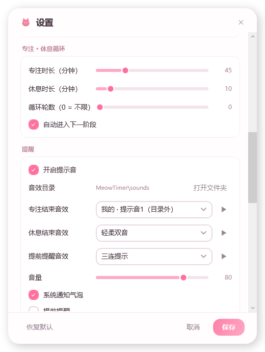

# 喵时 MeowTimer v1.1

一个很轻的 Windows 桌面倒计时 / 番茄钟 / 专注循环工具。透明悬浮窗、猫咪表情、滚轮调时间、全局快捷键、托盘实时显示 CPU/内存。


---

## 一、启动

双击 `MeowTimer.exe` 即可，无需安装。

- 启动后窗口出现在屏幕右上角，透明悬浮在所有窗口之上
- 同时出现一只猫咪托盘图标（右下角）
- 想让它开机自启：右键 → 设置 → 系统 → 勾选「开机自动启动」

> 系统要求：Windows 10 / 11 + .NET 8 Desktop Runtime（这台机器已经装好了）。
> 如果要拷到没装 .NET 的电脑上，跟我说一声，我给你出个自带运行时的便携版。

---

## 二、鼠标操作（记住这 5 条就够了）

| 操作 | 效果 |
| --- | --- |
| **单击**窗口 | 开始 / 暂停 |
| **按住拖动** | 移动窗口到任意位置（位置会自动记住） |
| **右键** | 打开菜单（换模式、编辑、置顶、设置、统计、退出） |
| **滚轮** | 平时**完全无效**（防止鼠标划过就改时间）；进入编辑模式后才调时间 |

窗口没有关闭按钮是故意的——点右上角 X 也只会收进托盘，不会退出。

### 编辑模式（改时间 / 改大小）

要调时间或者缩放窗口：**右键 →「✎ 进入编辑模式」**，窗口外圈会出现一圈虚线框，这时才能改：

| 操作 | 效果 |
| --- | --- |
| 滚轮 | 时间 ±1 分钟 |
| **Shift + 滚轮** | 时间 ±10 秒（精确微调） |
| **Ctrl + 滚轮** | 时间 ±5 分钟（想加半小时很省事） |
| **双击窗口** | 弹出设置框，时 / 分 / 秒 分开填 |
| **拖动右下角小圆点** | 缩放整个窗口（字号跟着变） |
| Alt + 滚轮 | 调背景不透明度 |
| 单击 | 不会启动计时（防误触） |
| 拖动窗口 | 移动位置 |

状态栏会显示「编辑中 · 滚轮调时间」，鼠标悬停还能看到完整操作提示。

退出：**右键 →「✓ 退出编辑模式」**，或直接按 **Esc**。

### 精确设置到秒

右键 →「设置倒计时…」，或者在编辑模式下**双击窗口**，会弹出这个：

```
[ 0 ] 时   [ 25 ] 分   [ 30 ] 秒
= 25 分 30 秒
[5 分] [15 分] [25 分] [45 分] [1 时]
```

- 三格都能直接打字，**精确到秒**
- 下面 5 个预设点一下就填好
- 「= xx 分 xx 秒」会实时显示总时长

「设置 → 计时 → 默认倒计时」也是**分 + 秒**两个格子，可以填 25 分 30 秒这种。

> **注意**：程序打开时是「暂停」状态，显示 `25:00` 和「点一下开始」，要**点一下窗口**（或按 `Ctrl+Alt+P`）才会开始走秒。
> 如果你希望一打开就自动开始倒计时，去「设置 → 计时」勾上「启动后自动开始倒计时」。

### 窗口找不到了？

接了两块以上显示器、或者换过分辨率之后，窗口可能跑到另一块屏幕上去了。三个办法叫回来：

1. **左键点托盘的小猫图标** → 窗口会回到鼠标所在的那块屏幕（就算它在别的显示器上）
2. 按 `Ctrl + Alt + H`
3. 右键菜单 →「窗口移回当前屏幕」

顺带说一句：程序只允许开一个。如果你又双击了一次 exe，已经在运行的那个会自己跳到前面来，不会多开一个。

### 窗口锁定

摆好位置不想被碰到？右键 →「**锁定窗口位置**」（或设置 → 外观 → 勾选「锁定窗口位置」），锁定后怎么拖都不会动，计时、点开始暂停都照常。

再点一次就解锁。

---

## 三、全局快捷键（任何程序里都能按）

| 快捷键 | 功能 |
| --- | --- |
| `Ctrl + Alt + P` | 开始 / 暂停 |
| `Ctrl + Alt + R` | 重置当前计时 |
| `Alt + Shift + T` | 弹出输入框设置倒计时 |
| `Ctrl + Alt + S` | 切换成「显示当前时间」时钟 |
| `Ctrl + Alt + H` | 显示 / 隐藏窗口 |
| `Ctrl + Alt + O` | 窗口置顶开关 |
| `Ctrl + Alt + D` | 启动番茄钟 |
| `Ctrl + Alt + B` | 启动「专注 · 休息循环」 |

全部可以在「设置 → 全局快捷键」里改成你顺手又没被别的软件占用的组合。

---

## 四、五种模式

- **倒计时**：默认 25 分钟，滚轮或菜单调时长
- **正计时**：从 0 开始往上记，适合记录"我到底学了多久"
- **当前时间**：变成桌面时钟，显示时间和星期
- **番茄钟**：工作 25 分 → 短休 5 分 → 4 轮后长休 15 分，自动循环
- **专注 · 休息循环** ⭐ 新：自己定专注时长和休息时长，专注结束提醒你休息，休息结束再提醒你回来接着专注，一直循环

### 专注 · 休息循环怎么用

右键菜单（或 `Ctrl + Alt + B`）→ 选「专注 · 休息循环」，就会按你设置的时长开始跑：

```
专注 45 分钟  →  喵！休息时间到  →  休息 10 分钟  →  叮～休息结束，回来吧  →  再专注 45 分钟 …
```

时长、是否自动开始下一阶段、循环几轮，都在「设置 → 专注 · 休息」里改（都是输入框，可以直接填秒）：

| 设置项 | 说明 |
| --- | --- |
| 专注时长 | 分 + 秒两栏，比如 45 分 0 秒 |
| 休息时长 | 分 + 秒两栏，比如 10 分 30 秒 |
| 循环轮数 | 跑几轮就停；填 **0** 表示一直循环不停 |
| 自动开始下一阶段 | 关掉的话，每段结束会停下等你点一下 |

窗口上会显示「专注中 · 第 2 轮」，一眼知道现在是第几轮、在专注还是在休息。


---

## 五、音效目录 ⭐ 新

程序自带 7 个音效，全部实时合成、不占体积：

> 喵叫 · 叮咚 · 铃铛 · 木琴三音 · 水滴 · 三连提示 · 轻柔双音

想换成自己的声音，有两种办法：

### 方法一：丢进音效文件夹（推荐）

设置 → 提醒 → 点「打开」，会打开：

```
C:\Users\<你的用户名>\AppData\Local\MeowTimer\sounds\
```

把 `.wav` / `.mp3` / `.m4a` / `.wma` 文件丢进去，回到设置里拉一下音效下拉框，就能看到「我的 · 文件名」，选中即可。

**想用自己的文件夹？** 点旁边的「**更改**」，随便选一个目录（比如 `D:\我的提示音`），程序就只扫那个文件夹了。路径后面会显示这个文件夹里有几个音频文件。点「**↺**」恢复默认目录。

放完文件不用重启，设置面板每 2 秒会自己扫一次 —— 而且**新出现的音效会自动被选中**，框里会提示「已加入 N 个音效 ✓」，不用自己去下拉里翻。

### 方法二：直接拖进来（最省事）

打开设置窗口，把你的 `mp3` / `wav` **直接拖到「把 mp3 / wav 文件拖到这里」那个框里**：

- 程序会自动把文件复制进当前音效目录
- 立刻在「专注结束音效」里选中它，并试听一声
- 框里会显示「已加入 N 个音效 ✓」

拖整个文件夹也可以，会把里面的音频都收进来。

支持格式：`wav` / `mp3` / `m4a` / `wma` / `flac` / `aac`。

### 方法三：直接选文件

音效下拉框里自带的那 7 个随便挑，也可以放自己的文件到上面那个文件夹。

### 三种事件可以配三种不同的声音

| 事件 | 什么时候响 |
| --- | --- |
| 专注结束音效 | 专注阶段 / 倒计时结束时 |
| 休息结束音效 | 休息阶段结束时（提醒你回来） |
| 提前提醒音效 | 开启「提前提醒」后，剩 N 秒时 |

每行右边的 **▶** 可以试听，音量用下面的滑块调。

这样就能做到：**专注结束是"喵"，休息结束是"叮咚"**，不用看屏幕光听声音就知道该干什么了。



---

## 六、到点提醒

时间到了会有三件事同时发生：

1. 播放对应的提示音（见上一节）
2. 窗口快速闪三下
3. 右下角弹出系统通知气泡（"休息时间到！" / "休息时间结束"）

---

## 七、外观

右键 → 设置 → 外观。**顶部有实时预览**：改主题、背景、字号、透明度、显示项时，上面那个小计时器会立刻变化，背后真实的窗口也会同步变 —— 所见即所得。点了「取消」会全部还原。

可以调：

- **6 套配色**：樱花粉 / 奶油布丁 / 薄荷苏打 / 夜空紫 / 落日橘 / 极简黑
  - 「极简黑」「夜空紫」是**深色模式**：设置面板、下拉框、对话框整套都变黑
  - 其余是浅色模式：淡色底 + 接近白的卡片
- **背景样式**（新）
  - **渐变**：跟着主题走的粉紫渐变（默认）
  - **纯色**：从下面 8 个颜色圆点里挑，点一下自动切过来
  - **无背景**：只剩数字和猫，完全透明、一点不挡视线；数字会自动加上深色描边，在亮色壁纸上也看得清
- **背景不透明度**：0% – 100%，拉到 0 就是全透
- **文字颜色**：默认「跟随主题」，也可以单独挑一个（白 / 黑 / 深灰 / 粉 / 紫 / 蓝 / 绿 / 橙），跟主题解耦
- **字号**：18 – 130（也可以直接拖右下角小圆点缩放窗口）
- **字体**：自带常用中文字体，也能手动输入任意已安装字体名
- 猫咪、进度条、状态文字都可以单独隐藏，只留数字

猫咪的表情会跟着状态变：专注时睁眼，暂停 / 结束时眯眼。

---

## 八、专注统计

右键 → 统计：

- 今日番茄数、今日专注时长、累计专注时长
- 近 7 天专注分钟柱状图（今天高亮）

番茄钟和专注循环的每个专注阶段，完成一次记 1 个番茄。

---

## 九、托盘图标

右键托盘图标可以快速操作；托盘图标本身还能变身：

设置 → 系统 → 托盘图标显示：**猫咪 / CPU 占用 / 内存占用**

选 CPU 或内存时，图标会每秒变成当前百分比数字，像一个小监控。

---

## 十、数据存在哪

全部在本机，不联网、不上传：

```
C:\Users\<你的用户名>\AppData\Local\MeowTimer\
├── config.json      设置
├── stats.json       专注统计
└── sounds\          音效文件夹（自己放音频进来）
```

删掉这个文件夹就完全恢复初始状态。

---

## 十一、命令行（进阶）

```bat
MeowTimer.exe 15m          启动并直接开始 15 分钟倒计时
MeowTimer.exe 1h30m        1 小时 30 分
MeowTimer.exe 90s          90 秒
MeowTimer.exe --cycle      启动并直接进入「专注 · 休息循环」
MeowTimer.exe --minimized  启动后只待在托盘
```

支持的时间写法：`25`（分钟）、`25m`、`90s`、`1h30m`、`1:30`、`25分钟`。

---

## 十二、小提示

- 只想看数字、不要背景？进编辑模式后 Ctrl+滚轮把字号调大、Shift+滚轮把不透明度拉到最低，再在设置里关掉猫咪和进度条。
- 上课 / 开会演示时，把窗口拖到投影区域，字号调大即可。
- 快捷键如果按了没反应，多半是被其他软件（输入法、截图工具、IDE）抢了，去设置里换一组。

---

## 更新记录

**v1.7.2**
- 修：窗口位置一直是 `NaN`（没保存），导致每次启动都回到默认位置
- 现在启动定位后会立刻把坐标写回配置，即使从没拖过也能记住
- 加了一层兜底：位置无效时不会覆盖磁盘上已有的坐标

**v1.7.1**
- 修：窗口位置记不住 —— 恢复时拿"过期的窗口宽度"算边界，把窗口往左挤了；现在按原样还原
- 修：拖完马上退出会丢位置，退出前再记一次
- 修：多显示器 / 负坐标屏幕下窗口被强行拉回主屏

**v1.7.0**
- macOS 版补齐**番茄钟**、**专注·休息循环**、**菜单栏托盘**（点图标可显示窗口、开始/暂停、退出）
- 关窗口不再退出程序，收进托盘继续计时

**v1.6.0**
- 新增 **macOS 版**（Avalonia 跨平台）：倒计时、主题、音效、悬浮窗都能用
- macOS 包由 GitHub Actions 在真 Mac 上自动构建
- Windows 版功能不变

**v1.5.3**
- 进度条改成跟随**字体颜色**，不再跟主题色走（字是蓝色，进度条也是蓝色）

**v1.5.2**
- 文字颜色**不再跟随主题**：选什么色就是什么色，换主题不会把数字颜色一起改掉
- 去掉数字的**外发光**，字边缘干净利落（无背景时只保留一圈紧贴的描边保证可读）

**v1.5.1**
- 新增**文字颜色**独立设置：主题管背景和强调色，数字颜色单独挑，两者互不影响
- 提供「跟随主题 + 8 种颜色」，浅色字自动配深描边、深色字自动配白描边，怎么搭都看得清
- 修：实时预览里白猫在浅色底上看不见

**v1.5.0**
- 新增**深色模式**：选「极简黑」或「夜空紫」，设置面板、下拉框、输入框、弹窗整套变黑，不再是白底
- 浅色主题保持原来的淡色风格，深浅两套配色自动切换
- 字体下拉改成统一样式（原来用系统组件，深色下面板会留白块）

**v1.4.4**
- 设置面板去掉刺眼的纯白卡片，改成**同色系三层淡色**：窗口底 → 卡片 → 输入框，层层递进
- 每个主题都有自己的整体色调（粉 / 淡紫灰 / 薄荷 / 暖橘 / 中性灰）

**v1.4.3**
- 设置面板**背景也跟随主题**：极淡的主题色底 + 纯白卡片，层次分明不刺眼
- 下拉框边框、分节标题、窗口外框与阴影都统一到主题配色
- 计时/统计等弹窗背景同样跟随

**v1.4.2**
- 去掉无背景模式下的边框，改成**数字直接使用主题色**（粉 / 紫 / 绿 / 橘），配深色描边，白底上也清楚
- 设置面板现在**跟着主题换色**：按钮、勾选框、输入框边框都随主题变
- 修：提示音偶尔卡顿 —— 合成结果改成缓存复用、播放器只创建一次、启动时预加载提醒音

**v1.4.1**
- 时长设置加上「时」，现在是 时 / 分 / 秒 三栏
- 修：无背景模式下换主题几乎看不出来 —— 现在无背景时窗口会有一圈**主题色细边框**，猫咪腮红也跟主题变色
- 每个主题都配了自己的深色描边，浅色壁纸上依然清楚

**v1.4.0**
- 设置面板**全面改成输入框**，不再用滑块 —— 时长类都是「分 + 秒」两栏，精确到秒
- 番茄钟的工作 / 短休息 / 长休息、专注·休息循环的专注 / 休息时长，全部支持秒级设置
- 字号、背景不透明度、音量、提前秒数、番茄数、循环轮数也改成直接输入
- 老配置里的分钟数自动换算成秒，不用重设

**v1.3.3**
- 往音效文件夹里丢新文件时，设置面板会**自动选中新音效**并提示，不用自己去下拉里翻
- 修：文件明明在音效目录里却显示「（目录外）」的比对 bug

**v1.3.2**
- 新增**拖拽添加音效**：把 mp3 / wav 直接拖到设置窗口的虚线框里，自动复制进音效目录 + 选中 + 试听
- 支持格式扩展到 wav / mp3 / m4a / wma / flac / aac，拖文件夹也行
- 修：文件明明在音效目录里却显示「（目录外）」的问题（路径分隔符不一致导致比对失败）
- 修：绑定的音频文件被移走后完全没声音 → 现在自动退回内置喵叫

**v1.3.1**
- 新增**锁定窗口位置**：右键菜单 / 设置里勾选，锁上之后拖不动，防止碰歪
- 新增**自定义音效目录**：设置 → 提醒 →「更改」，可以选任意文件夹当音效库；「↺」恢复默认
- 音效目录后面会显示该文件夹里有多少个音频文件

**v1.3.0**
- 新增外观**实时预览**：设置面板顶部一个迷你计时器，改任何外观参数立刻能看到效果；同时真实窗口同步变化，取消则全部还原
- 新增**精确到秒**的时间设置：时长对话框改成 时/分/秒 三栏 + 常用预设
- 改：默认倒计时（设置 → 计时）也改成 分 + 秒 两个输入格
- 改：编辑模式滚轮 —— Shift ±10 秒（精确）、Ctrl ±5 分钟（大步）、滚轮 ±1 分钟
- 字号改由右下角手柄拖拽控制

**v1.2.0**
- 新增窗口缩放：编辑模式下拖右下角小圆点，整个窗口按比例放大缩小
- 新增背景样式：渐变 / 纯色（8 色可选）/ 无背景；无背景时数字自动加深色描边，不挡视线也看得清
- 背景不透明度范围放宽到 0–100%
- 改：时长编辑方式 —— 双击窗口可直接输入；Shift+滚轮一次 ±5 分钟；滚轮仍为 ±1 分钟
- 改：Alt+滚轮调不透明度，Ctrl+滚轮调字号
- 编辑模式加操作提示 ToolTip

**v1.1.3**
- 新增「编辑模式」：平时滚轮完全失效，进编辑模式才能调时间 / 字号 / 透明度，外圈有虚线框提示，Esc 退出
- 修：鼠标掠过窗口滑动滚轮会误改时间的问题

**v1.1.2**
- 修：多显示器时窗口跑到不看的屏幕上（现在启动会出现在鼠标所在屏幕的右上角）
- 修：左键点托盘改为一律"叫出窗口"，原来会切换隐藏，点了反而找不到
- 新增：右键菜单「窗口移回当前屏幕」
- 新增：再次双击 exe 会把已运行的窗口叫到前面，而不是只弹一句提示
- 窗口出现时加了淡入动画

**v1.1.1**
- 修：点击窗口的判定阈值太严（3px），手一抖就被当成拖动窗口，导致"点了没开始"
- 新增：设置 → 计时 → 「启动后自动开始倒计时」

**v1.1**
- 新增「专注 · 休息循环」模式：专注结束提醒休息，休息结束提醒回来，可设轮数和是否自动继续
- 新增音效目录 `sounds\`，可放自己的 mp3/wav；内置音效从 1 个扩展到 7 个
- 专注结束 / 休息结束 / 提前提醒可以分别配不同音效，支持试听
- 老版本填过的自定义提示音会自动迁移到「专注结束音效」

**v1.0**
- 第一个版本：倒计时 / 正计时 / 时钟 / 番茄钟、托盘、全局快捷键、统计、6 套配色

---

由肖肖 & 小A 一起做的 🐱
